<h1 align="center">goodui</h1>

<p align="center">Free, MIT-licensed animated React components and app blocks for shadcn/ui.<br>You get the source, in your project. No runtime package.</p>

<p align="center">
  <a href="https://goodui.dev"><b>Live previews</b></a> &nbsp;·&nbsp;
  <a href="#install"><b>Install</b></a> &nbsp;·&nbsp;
  <a href="#whats-here"><b>What's here</b></a> &nbsp;·&nbsp;
  <a href="#templates"><b>Templates</b></a> &nbsp;·&nbsp;
  <a href="https://goodui.dev/pricing"><b>Pro</b></a>
</p>

<p align="center">
  <a href="./LICENSE"></a>
  
  
</p>

<a href="https://goodui.dev/blocks/scheduling#resource-timeline">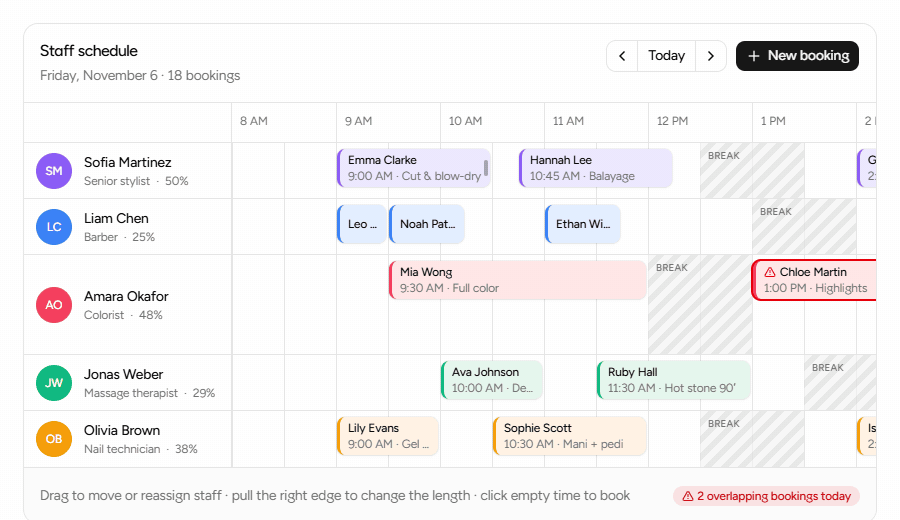</a>

<p align="center"><sub>Resource timeline: drag, resize, conflicts, click to book. <a href="https://goodui.dev/blocks/scheduling#resource-timeline">Try it live</a>.</sub></p>

<p align="center">If goodui saves you time, a star helps other developers find it.</p>

## Showcase

Recorded from the live previews at [goodui.dev](https://goodui.dev). Everything shown here is free and in this repository.

<table>
<tr>
<td width="50%" valign="top"><a href="https://goodui.dev/components/numbers/number-flow">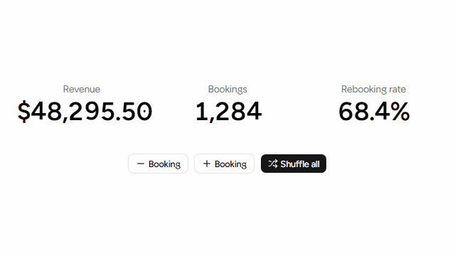</a><br><a href="https://goodui.dev/components/numbers/number-flow"><b>Number flow</b></a><br><sub>Digits roll to the new value.</sub></td>
<td width="50%" valign="top"><a href="https://goodui.dev/components/buttons/hold-to-confirm">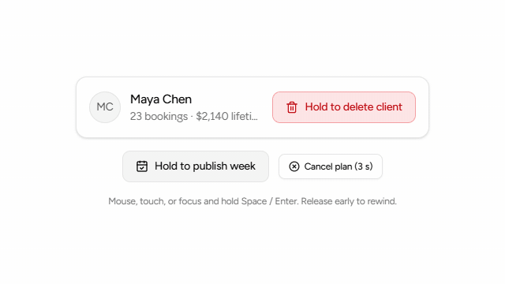</a><br><a href="https://goodui.dev/components/buttons/hold-to-confirm"><b>Hold to confirm</b></a><br><sub>Press and hold for destructive actions.</sub></td>
</tr>
<tr>
<td width="50%" valign="top"><a href="https://goodui.dev/components/charts/donut-chart">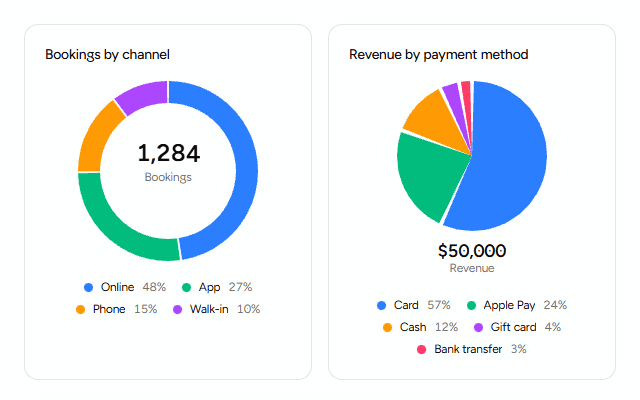</a><br><a href="https://goodui.dev/components/charts/donut-chart"><b>Donut chart</b></a><br><sub>Segments and the total animate together.</sub></td>
<td width="50%" valign="top"><a href="https://goodui.dev/components/navigation/tabs-indicator">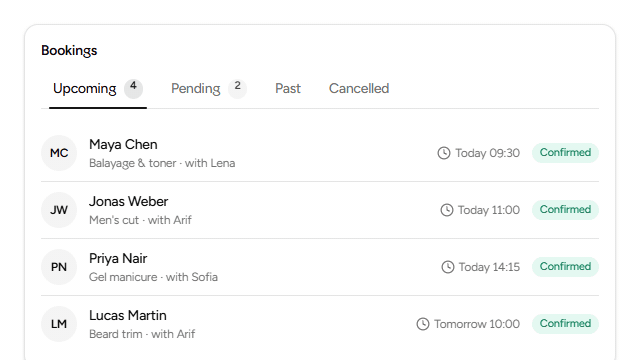</a><br><a href="https://goodui.dev/components/navigation/tabs-indicator"><b>Tabs indicator</b></a><br><sub>An indicator that slides between tabs.</sub></td>
</tr>
<tr>
<td width="50%" valign="top"><a href="https://goodui.dev/components/backgrounds/aurora">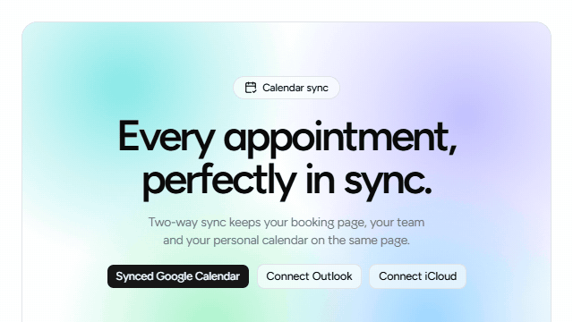</a><br><a href="https://goodui.dev/components/backgrounds/aurora"><b>Aurora</b></a><br><sub>An ambient background for heroes.</sub></td>
<td width="50%" valign="top"><b>132 components, 39 blocks</b><br><sub>See the <a href="https://goodui.dev/components">full gallery</a>.</sub></td>
</tr>
</table>

## Install

You need a React project with Tailwind CSS 4 and [shadcn/ui](https://ui.shadcn.com/docs/installation) set up. Then add anything by URL:

```bash
npx shadcn@latest add https://goodui.dev/r/number-flow.json
npx shadcn@latest add https://goodui.dev/r/resource-timeline.json
```

Or register the namespace once in `components.json`:

```json
{
  "registries": {
    "@goodui": "https://goodui.dev/r/{name}.json"
  }
}
```

```bash
npx shadcn@latest add @goodui/hold-to-confirm
```

Components land in `components/goodui/`, and their dependencies come along. The source is yours to edit.

## What's here

### Blocks (39)

| Category | Blocks |
| --- | --- |
| Scheduling & Booking | [Week scheduler](https://goodui.dev/blocks/scheduling#scheduler-week), [Resource timeline](https://goodui.dev/blocks/scheduling#resource-timeline), [Slot picker](https://goodui.dev/blocks/scheduling#slot-picker), [Today's schedule](https://goodui.dev/blocks/scheduling#today-schedule), [Day agenda](https://goodui.dev/blocks/scheduling#day-agenda), [Waitlist manager](https://goodui.dev/blocks/scheduling#waitlist-manager) |
| Dashboards & Stats | [KPI cards](https://goodui.dev/blocks/dashboard#kpi-cards), [Activity heatmap](https://goodui.dev/blocks/dashboard#activity-heatmap) |
| Forms & Settings | [Notification settings](https://goodui.dev/blocks/settings#notification-settings), [Profile settings](https://goodui.dev/blocks/settings#profile-settings), [Localization settings](https://goodui.dev/blocks/settings#localization-settings) |
| App Shell & Navigation | [Page header actions](https://goodui.dev/blocks/app-shell#page-header-actions) |
| Tables & Lists | [Contacts directory](https://goodui.dev/blocks/tables#contacts-directory), [Approvals queue](https://goodui.dev/blocks/tables#approvals-queue), [Schema browser](https://goodui.dev/blocks/tables#schema-browser), [Export center](https://goodui.dev/blocks/tables#export-center) |
| Onboarding & Empty States | [Setup checklist](https://goodui.dev/blocks/onboarding#setup-checklist), [Empty states](https://goodui.dev/blocks/onboarding#empty-states), [Import progress](https://goodui.dev/blocks/onboarding#import-progress) |
| Billing | [Usage meters](https://goodui.dev/blocks/billing#usage-meters), [Usage alerts](https://goodui.dev/blocks/billing#usage-alerts) |
| Authentication | [Split sign-in](https://goodui.dev/blocks/auth#sign-in-split), [OTP verification](https://goodui.dev/blocks/auth#otp-verify), [Password reset](https://goodui.dev/blocks/auth#password-reset), [Magic link sent](https://goodui.dev/blocks/auth#magic-link-sent) |
| Notifications & Activity | [Activity feed](https://goodui.dev/blocks/notifications#activity-feed), [What's new](https://goodui.dev/blocks/notifications#whats-new) |
| AI Chat | [Prompt composer](https://goodui.dev/blocks/ai#prompt-composer), [Prompt library](https://goodui.dev/blocks/ai#prompt-library), [Fine-tune job list](https://goodui.dev/blocks/ai#fine-tune-jobs) |
| Service Business | [Client profile](https://goodui.dev/blocks/booking#client-profile), [Gift card issue](https://goodui.dev/blocks/booking#gift-card-issue), [Consent form with signature](https://goodui.dev/blocks/booking#consent-form) |
| Marketing Site | [Hero with product shot](https://goodui.dev/blocks/marketing#hero-product-shot), [Logo cloud marquee](https://goodui.dev/blocks/marketing#logo-cloud-marquee), [FAQ accordion](https://goodui.dev/blocks/marketing#faq-accordion), [Stats band with counting numbers](https://goodui.dev/blocks/marketing#stats-band), [Newsletter signup](https://goodui.dev/blocks/marketing#newsletter-signup) |
| Commerce | [Order tracking](https://goodui.dev/blocks/commerce#order-tracking) |

### Components (132)

Each link opens a usage guide.

<details><summary><b>numbers</b> (8)</summary>

[Number flow](docs/numbers/number-flow.md) · [Counter up](docs/numbers/counter-up.md) · [Usage meter](docs/numbers/meter.md) · [Progress](docs/numbers/progress.md) · [Circular progress](docs/numbers/circular-progress.md) · [Sparkline draw](docs/numbers/sparkline-draw.md) · [Delta badge](docs/numbers/delta-badge.md) · [Cell flash](docs/numbers/cell-flash.md)

</details>
<details><summary><b>buttons</b> (10)</summary>

[Shimmer button](docs/buttons/shimmer-button.md) · [Ripple button](docs/buttons/ripple-button.md) · [Rainbow button](docs/buttons/rainbow-button.md) · [Border beam button](docs/buttons/border-beam-button.md) · [Magnetic button](docs/buttons/magnetic-button.md) · [Stateful button](docs/buttons/stateful-button.md) · [Copy button](docs/buttons/copy-button.md) · [Hold to confirm](docs/buttons/hold-to-confirm.md) · [Liquid glass button](docs/buttons/liquid-glass-button.md) · [Theme toggle](docs/buttons/theme-toggle.md)

</details>
<details><summary><b>navigation</b> (6)</summary>

[Tabs indicator](docs/navigation/tabs-indicator.md) · [Segmented control](docs/navigation/segmented-control.md) · [Stepper](docs/navigation/stepper.md) · [Dock](docs/navigation/dock.md) · [Bottom navigation](docs/navigation/bottom-nav.md) · [Command palette morph](docs/navigation/command-palette-morph.md)

</details>
<details><summary><b>overlays</b> (5)</summary>

[Morphing dialog](docs/overlays/morphing-dialog.md) · [Spring drawer](docs/overlays/drawer-spring.md) · [Popover morph](docs/overlays/popover-morph.md) · [Animated tooltip](docs/overlays/tooltip-animated.md) · [Stagger dropdown](docs/overlays/dropdown-stagger.md)

</details>
<details><summary><b>lists</b> (6)</summary>

[Accordion height](docs/lists/accordion-height.md) · [List reorder](docs/lists/list-reorder.md) · [Table row presence](docs/lists/table-row-presence.md) · [Animated list](docs/lists/animated-list.md) · [Tree expand](docs/lists/tree-expand.md) · [Expandable row list](docs/lists/expandable-row-list.md)

</details>
<details><summary><b>inputs</b> (10)</summary>

[Tag input](docs/inputs/tag-input.md) · [OTP input](docs/inputs/otp-input.md) · [Floating label input](docs/inputs/floating-label-input.md) · [Vanish input](docs/inputs/vanish-input.md) · [Input shake](docs/inputs/input-shake.md) · [Spring switch](docs/inputs/switch-spring.md) · [Drawn checkbox](docs/inputs/checkbox-draw.md) · [Slider with tooltip](docs/inputs/slider-tooltip.md) · [Expanding search](docs/inputs/search-expand.md) · [File drop zone](docs/inputs/file-drop-pulse.md)

</details>
<details><summary><b>text</b> (9)</summary>

[Text reveal](docs/text/text-reveal.md) · [Typewriter](docs/text/typewriter.md) · [Word rotate](docs/text/word-rotate.md) · [Shiny text](docs/text/shiny-text.md) · [Gradient text](docs/text/gradient-text.md) · [Scramble text](docs/text/scramble-text.md) · [Highlighter](docs/text/highlighter.md) · [Text morph](docs/text/text-morph.md) · [Scroll velocity](docs/text/scroll-velocity.md)

</details>
<details><summary><b>cards</b> (6)</summary>

[Spotlight card](docs/cards/spotlight-card.md) · [Tilt card](docs/cards/tilt-card.md) · [Border beam](docs/cards/border-beam.md) · [Glow border](docs/cards/glow-border.md) · [Progressive blur](docs/cards/progressive-blur.md) · [Expandable card](docs/cards/expandable-card.md)

</details>
<details><summary><b>backgrounds</b> (5)</summary>

[Dot grid](docs/backgrounds/dot-grid.md) · [Flickering grid](docs/backgrounds/flickering-grid.md) · [Aurora](docs/backgrounds/aurora.md) · [Particles](docs/backgrounds/particles.md) · [Marquee](docs/backgrounds/marquee.md)

</details>
<details><summary><b>feedback</b> (7)</summary>

[Toast stack](docs/feedback/toast-stack.md) · [Notification badge](docs/feedback/notification-badge.md) · [Skeleton auto](docs/feedback/skeleton-auto.md) · [Spinners](docs/feedback/spinners.md) · [Multi-step loader](docs/feedback/multi-step-loader.md) · [Confetti](docs/feedback/confetti.md) · [Success check](docs/feedback/success-check.md)

</details>
<details><summary><b>core</b> (30)</summary>

[Button](docs/core/button.md) · [Badge](docs/core/badge.md) · [Card](docs/core/card.md) · [Input](docs/core/input.md) · [Avatar](docs/core/avatar.md) · [Alert](docs/core/alert.md) · [Tabs](docs/core/tabs.md) · [Switch](docs/core/switch.md) · [Checkbox & Radio](docs/core/checkbox.md) · [Separator](docs/core/separator.md) · [Breadcrumb](docs/core/breadcrumb.md) · [Pagination](docs/core/pagination.md) · [Heading](docs/core/heading.md) · [Text](docs/core/text.md) · [Link](docs/core/link.md) · [Kbd](docs/core/kbd.md) · [Stat Card](docs/core/stat-card.md) · [Select](docs/core/select.md) · [Dialog & Sheet](docs/core/dialog.md) · [Tooltip](docs/core/tooltip.md) · [Popover](docs/core/popover.md) · [Dropdown Menu](docs/core/dropdown-menu.md) · [Combobox](docs/core/combobox.md) · [Date Picker](docs/core/date-picker.md) · [Multi-step Form](docs/core/multi-step-form.md) · [Number Input](docs/core/number-input.md) · [Rating](docs/core/rating.md) · [Toggle Group](docs/core/toggle-group.md) · [Table](docs/core/table.md) · [Data Grid](docs/core/data-grid.md)

</details>
<details><summary><b>ai</b> (16)</summary>

[Chat message](docs/ai/chat-message.md) · [Streaming text](docs/ai/streaming-text.md) · [Tool call](docs/ai/tool-call.md) · [Reasoning block](docs/ai/reasoning-block.md) · [Model picker](docs/ai/model-picker.md) · [Chat composer](docs/ai/chat-composer.md) · [Citations](docs/ai/citations.md) · [Agent plan](docs/ai/agent-plan.md) · [Token meter](docs/ai/token-meter.md) · [Voice orb](docs/ai/voice-orb.md) · [Diff view](docs/ai/diff-view.md) · [Code block](docs/ai/code-block.md) · [Suggestion chips](docs/ai/suggestion-chips.md) · [Thread list](docs/ai/thread-list.md) · [Eval score](docs/ai/eval-score.md) · [Typing indicator](docs/ai/typing-indicator.md)

</details>
<details><summary><b>charts</b> (14)</summary>

[Area chart](docs/charts/area-chart.md) · [Line chart](docs/charts/line-chart.md) · [Bar chart](docs/charts/bar-chart.md) · [Donut chart](docs/charts/donut-chart.md) · [Radial progress](docs/charts/radial-progress.md) · [Heatmap](docs/charts/heatmap.md) · [Funnel chart](docs/charts/funnel-chart.md) · [Gauge](docs/charts/gauge.md) · [Bump chart](docs/charts/bump-chart.md) · [Treemap](docs/charts/treemap.md) · [Timeline chart](docs/charts/timeline-chart.md) · [Waterfall chart](docs/charts/waterfall-chart.md) · [KPI trend](docs/charts/kpi-trend.md) · [Chart legend](docs/charts/chart-legend.md)

</details>

Also included: the scheduler engine (`components/slotgrid`), shared motion tokens, optional UI sounds, and 19 language packs for component labels.

## Templates

Finished pages you start from instead of a blank file: 65 landing pages and dashboards across 14 design kits, and 10 React Native app templates. Each kit has its own page model, navigation, type and motion. They ship as Next.js and Tailwind source with [goodui Pro](https://goodui.dev/pricing).

<table>
<tr>
<td width="50%" valign="top"><a href="https://goodui.dev/kits/index/coding-agent">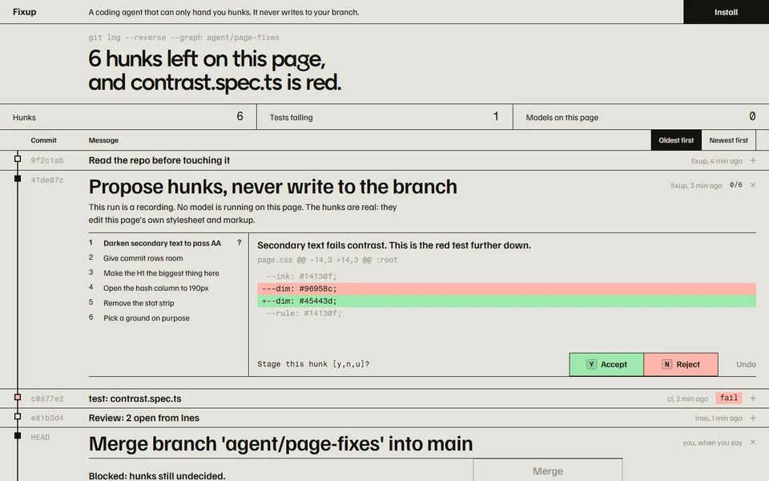</a><br><a href="https://goodui.dev/kits/index/coding-agent"><b>Fixup</b></a><br><sub>Index kit. A git log that is the page: accept a hunk and the page changes.</sub></td>
<td width="50%" valign="top"><a href="https://goodui.dev/kits/atlas/visibility">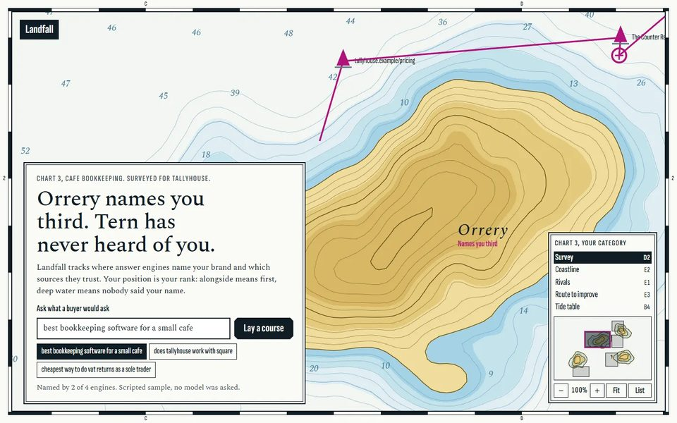</a><br><a href="https://goodui.dev/kits/atlas/visibility"><b>Landfall</b></a><br><sub>Atlas kit. A nautical chart where answer engines are islands.</sub></td>
</tr>
<tr>
<td width="50%" valign="top"><a href="https://goodui.dev/kits/strata/appsec">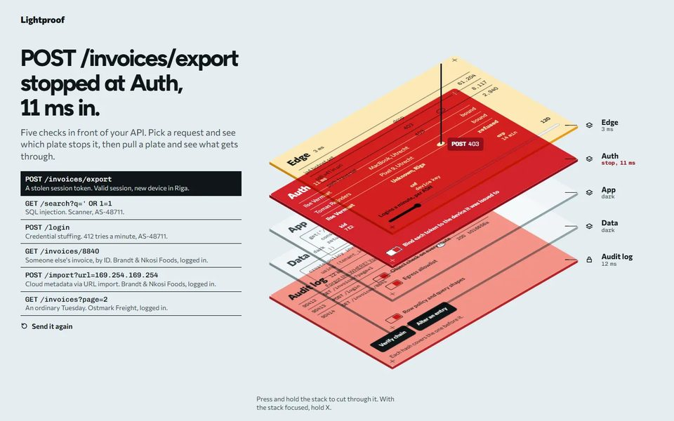</a><br><a href="https://goodui.dev/kits/strata/appsec"><b>Lightproof</b></a><br><sub>Strata kit. One request falls through five layers of film.</sub></td>
<td width="50%" valign="top"><a href="https://goodui.dev/kits/marginalia/contract">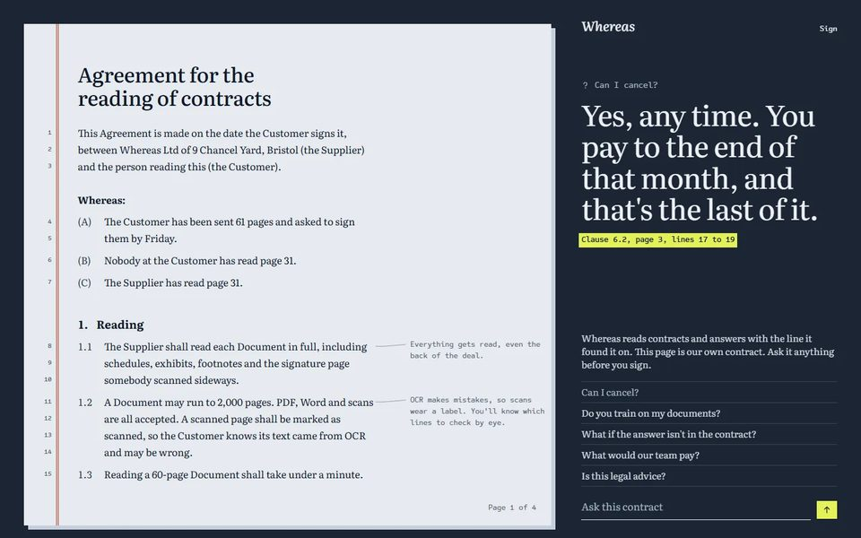</a><br><a href="https://goodui.dev/kits/marginalia/contract"><b>Whereas</b></a><br><sub>Marginalia kit. A contract with an AI collaborator in the margin.</sub></td>
</tr>
<tr>
<td width="50%" valign="top"><a href="https://goodui.dev/kits/one-window/approvals">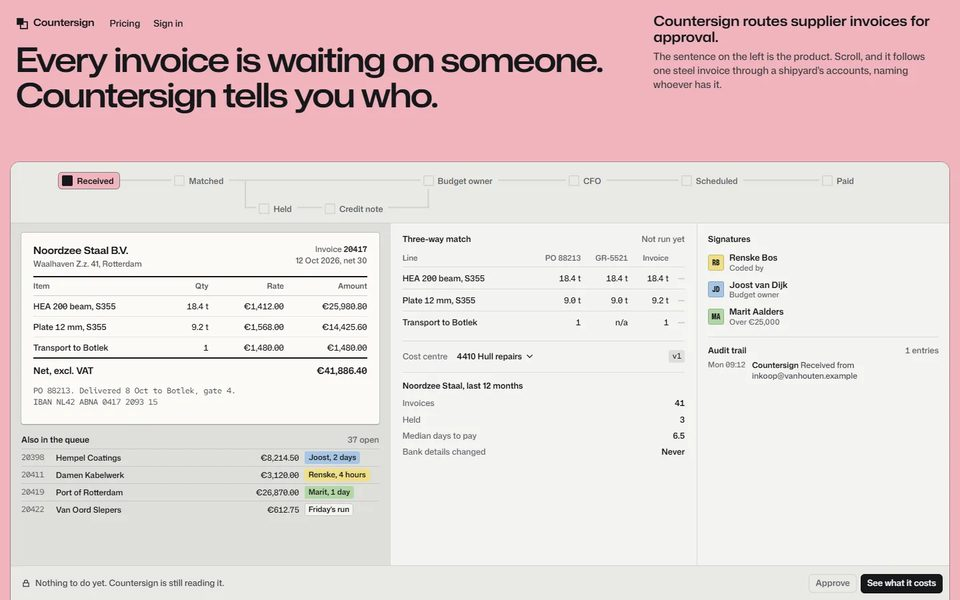</a><br><a href="https://goodui.dev/kits/one-window/approvals"><b>Countersign</b></a><br><sub>One Window kit. One product window stays pinned while you scroll.</sub></td>
<td width="50%" valign="top"><a href="https://goodui.dev/kits/lumen/finance">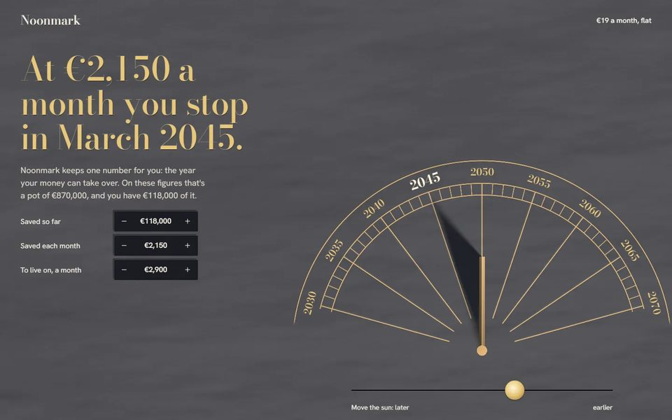</a><br><a href="https://goodui.dev/kits/lumen/finance"><b>Noonmark</b></a><br><sub>Lumen kit. A sundial whose shadow falls on the year you stop working.</sub></td>
</tr>
</table>

<p align="center"><a href="https://goodui.dev/kits"><b>See all 65 pages, with recordings</b></a></p>

## Pro

This repository holds the free part of goodui. [goodui Pro](https://goodui.dev/pricing) adds **150 Pro components**, 111 more blocks, the templates above and the React Native screens and apps. None of that is in this repository: Pro installs with the same shadcn CLI and a license key.

**Added this week**

<table>
<tr>
<td width="50%" valign="top"><a href="https://goodui.dev/components/pro/lanyard-badge">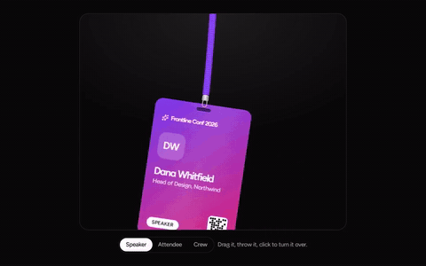</a><br><a href="https://goodui.dev/components/pro/lanyard-badge"><b>Lanyard badge</b></a><br><sub>An ID badge on a strap with rope physics. Drag it, throw it, turn it over.</sub></td>
<td width="50%" valign="top"><a href="https://goodui.dev/components/pro/scroll-stack">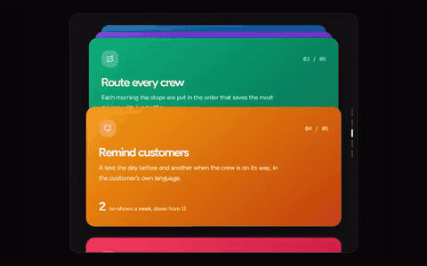</a><br><a href="https://goodui.dev/components/pro/scroll-stack"><b>Scroll stack</b></a><br><sub>Cards that pin and pile up as you scroll.</sub></td>
</tr>
<tr>
<td width="50%" valign="top"><a href="https://goodui.dev/components/pro/glitch-text">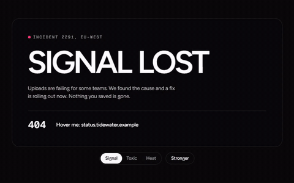</a><br><a href="https://goodui.dev/components/pro/glitch-text"><b>Glitch text</b></a><br><sub>Text that tears like a bad signal, in pure CSS.</sub></td>
<td width="50%" valign="top"><a href="https://goodui.dev/components/pro/image-trail">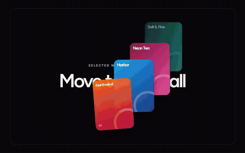</a><br><a href="https://goodui.dev/components/pro/image-trail"><b>Image trail</b></a><br><sub>Pictures pop in behind the pointer, drift on and fade.</sub></td>
</tr>
<tr>
<td width="50%" valign="top"><a href="https://goodui.dev/components/pro/flip-card">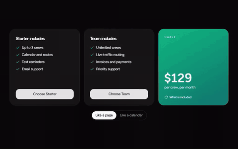</a><br><a href="https://goodui.dev/components/pro/flip-card"><b>Flip card</b></a><br><sub>A two-sided card that turns on a spring.</sub></td>
<td width="50%" valign="top"><a href="https://goodui.dev/components/pro/curved-marquee">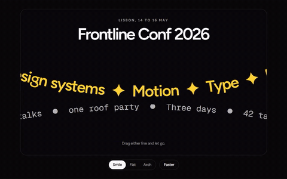</a><br><a href="https://goodui.dev/components/pro/curved-marquee"><b>Curved marquee</b></a><br><sub>Text running along a curve that you can drag and throw.</sub></td>
</tr>
</table>

**More from Pro**

<table>
<tr>
<td width="50%" valign="top"><a href="https://goodui.dev/components/pro/holo-card">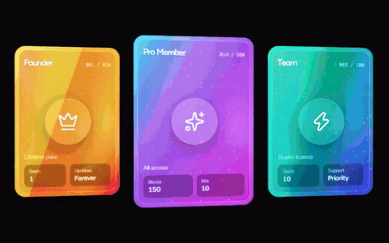</a><br><a href="https://goodui.dev/components/pro/holo-card"><b>Holo card</b></a><br><sub>Foil that follows the pointer and the light.</sub></td>
<td width="50%" valign="top"><a href="https://goodui.dev/components/pro/device-showcase-3d">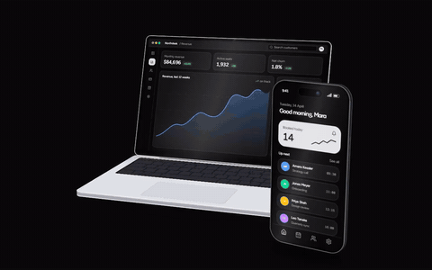</a><br><a href="https://goodui.dev/components/pro/device-showcase-3d"><b>3D device showcase</b></a><br><sub>Your UI on a laptop and phone in real 3D.</sub></td>
</tr>
<tr>
<td width="50%" valign="top"><a href="https://goodui.dev/components/pro/particle-morph-text">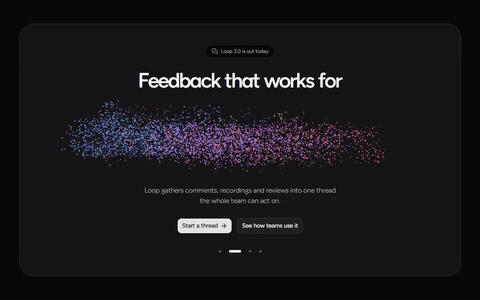</a><br><a href="https://goodui.dev/components/pro/particle-morph-text"><b>Particle morph text</b></a><br><sub>Words dissolve into particles and reform.</sub></td>
<td width="50%" valign="top"><a href="https://goodui.dev/components/pro/card-deck-swipe">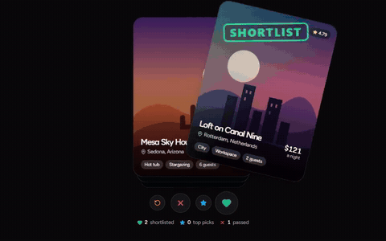</a><br><a href="https://goodui.dev/components/pro/card-deck-swipe"><b>Card deck swipe</b></a><br><sub>A physics card stack you fling away.</sub></td>
</tr>
<tr>
<td width="50%" valign="top"><a href="https://goodui.dev/components/pro/page-flip-book">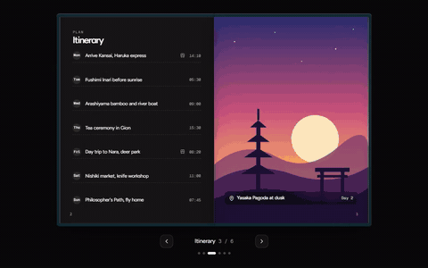</a><br><a href="https://goodui.dev/components/pro/page-flip-book"><b>Page flip book</b></a><br><sub>Real page curl, drag or click to turn.</sub></td>
<td width="50%" valign="top"><a href="https://goodui.dev/components/pro/lens-glass">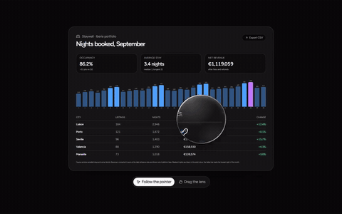</a><br><a href="https://goodui.dev/components/pro/lens-glass"><b>Lens glass</b></a><br><sub>A refracting glass lens over any content.</sub></td>
</tr>
</table>

<p align="center"><a href="https://goodui.dev/components/pro"><b>See all 150 Pro components</b></a> &nbsp;·&nbsp; <a href="https://goodui.dev/pricing"><b>Pricing</b></a> (one payment, lifetime updates, 14-day refund)</p>

Everything here stays free and MIT licensed.

## Repository layout

```
registry/components/   component source
registry/blocks/       block source
components/slotgrid/   scheduler engine
lib/                   motion, sounds and locale helpers
docs/                  usage guides
registry.json          shadcn registry manifest
```

## License

[MIT](./LICENSE)
